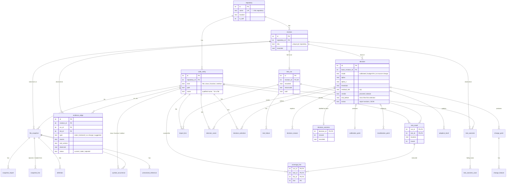
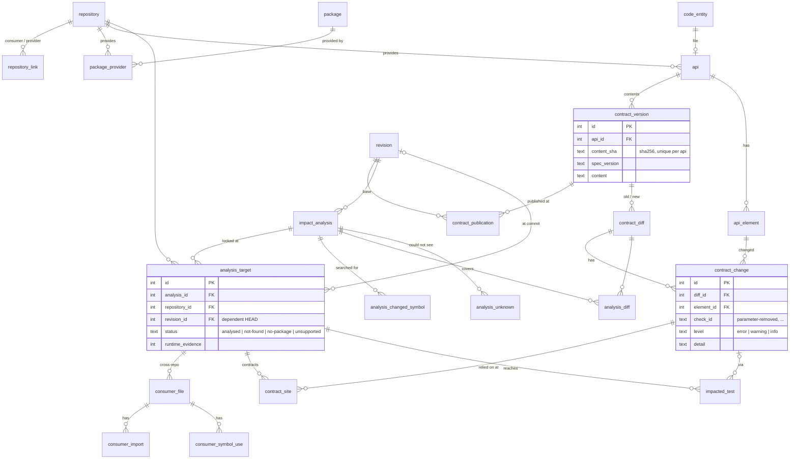

# Evidence database

CodeTwin keeps all evidence for a repository in one SQLite file, `.codetwin/evidence.sqlite`. Only code in
`store/` reads or writes it: `store/db.py` (`Store`) and, for cross-repository and contract analyses,
`store/analyses.py`. Every other module goes through them, so the schema can change without touching callers. The
schema is `src/codetwin/store/migrations/0003_evidence_model.sql` (evidence, decisions, learning) and
`0004_crossrepo_contracts.sql` (connected repositories and API contracts).

## Why it is normalized

Up to migration 0002 the store held one JSON blob per run, per file and per decision, plus a key–value `state`
table for learning histories. That was easy to write, but the database could not answer the questions the method
depends on. "Which tests executed line 42 of `price.py`?" needed every coverage blob loaded and parsed. "Which
decision is this calibration point from?" had no answer, because the histories were bare lists. And nothing stopped
a decision from pointing at a run that did not exist.

Since 0003, the layout follows the evidence model in Section IV of the paper:

* **Identities are stored once.** A path, commit or test file appears in one row of `revision` or `code_entity`, and
  everything else refers to it by id.
* **One row per fact.** Every list in the evidence model is its own table, so SQL can join, count and index it.
* **Typed links.** Each link records what kind of evidence found it (static, runtime, declared, co-change,
  suggested or unresolved) and where it came from. Unknown links are kept as rows (`unresolved_reference`) and are
  never silently dropped.
* **Integrity.** Foreign keys are on, `CHECK` constraints limit fields to their valid values (decision verdicts,
  modes, test-outcome sources, symbol kinds, labels in {0, 1}, α in (0, 1), risk in [0, 1]), and deleting a run,
  snapshot or decision deletes everything that hangs off it.
* **Audit trail.** Learning state is append-only and linked to the decision that produced it, so the history of
  αt and of every calibration point can be replayed.

## Entity–relationship diagram

The diagram lists the key columns of the central tables. The SQL file gives every column, with a comment on each.

## Tables by layer

| Layer | Tables | Filled by |
|---|---|---|
| Code model | `repository`, `revision`, `code_entity` | every write; ids are created on first use. Row 1 of `repository` is this repository; paths and shas are unique per repository, so a connected repository's `src/app.py` is a different entity from ours |
| Static evidence | `file_snapshot` and its children `snapshot_import`, `snapshot_line`, `definition`, `symbol_occurrence`, `unresolved_reference`; `evidence_edge` (type `static`) | `codetwin record` → `Store.save_static` |
| Runtime evidence | `test_run`, `test_result`, `test_failure`, `coverage_line`, `import_line` | `codetwin record` → `Store.save_run` |
| Test history | `test_outcome`, `test_outcome_case` | recorded runs, `codetwin outcomes` (CI), `codetwin why` reruns |
| Decisions | `decision`, `decision_score`, `decision_selection`, `decision_reason`, `decision_outcome` | `codetwin select`, then `codetwin learn` |
| Learning | `calibration_point`, `recalibration_point`, `change_point`, `change_feature`, `adaptive_level` | `codetwin learn` |
| Scratch | `setting` (JSON) | values that are not evidence, e.g. features waiting for their label |

Runtime links are not copied into `evidence_edge`: they come from `coverage_line`. Keeping one copy means the two
can never disagree.

`evidence_edge` accepts four types. Only `static` is written today. The other three are reserved for the evidence
sources the paper proposes but does not evaluate. `declared` and `co-change` will need a writer before they are
used. `suggested` links come from a language model, and the paper never lets them drive selection.

## Views

| View | Answers |
|---|---|
| `evidence` | every typed link of a revision in one shape: static edges, runtime links (test → file, derived from coverage) and unresolved references (file → nothing) |
| `latest_run` | the most recent full run and its sha |
| `labelled_decision` | decisions together with their `learn` outcome; used for the observed miss rate (`/api/calibration`, `promise` report) |
| `flaky_test` | test files that both passed and failed on the same revision |

## Indexes

Every primary key is an index. In addition:

* `coverage_by_line (run_id, file_id, line)` answers "which tests executed this line" (`Store.tests_covering`)
  without scanning the run;
* `evidence_edge_dst (dst_id, revision_id)` gives reverse dependencies (who depends on this file);
* `test_outcome_by_test (test_id, recorded)` serves the per-test history that failure triage reads;
* `decision_by_mode (mode, id)` serves the miss-rate queries over calibrated decisions.

## Order and exactness

Some analysers emit lists in a meaningful order (for example `FileFacts.deps`). Tables holding such lists have an
`ordinal` column, so `get_static` and `get_run` return exactly what was written. The tests check this by round trip
(`tests/test_store.py`). Two things are deliberately not kept:

* a source file with an empty line list inside `covered` or `import_lines` (an empty set is not evidence);
* NaN scores, which SQL cannot represent; they are stored as null and read back as NaN.

## Transactions and migrations

The connection uses explicit transactions. Each `Store` write method is one transaction, and nested calls join the
outer one. So a decision and its selections, reasons and scores are stored together or not at all.

A migration is a `NNNN_<name>.sql` file. It is applied once, in name order, and tracked in the `migrations` table.
If a migration also has to move data, it registers a Python step in `store/legacy.py` (`STEPS`). The step runs in
the same transaction as the SQL, and the migration is recorded only if both succeed. If either fails, the database
stays exactly as it was (`test_failed_migration_step_rolls_back`).

Migration 0003 moves every row of the 0001/0002 tables into the new tables, keeping decision ids, and then drops the
old tables. Learning histories that the old store kept as bare lists come across in order but with no decision,
because the old store never recorded which decision they belonged to. The old `last_decision.scores` become the
scores of that decision. The upgrade was checked on 17 databases from earlier runs: runs, static facts, decisions and
outcomes all read back identically, and `pragma foreign_key_check` is clean.

Migration 0005 (decision log) adds `decision.risk_before` and `decision.extras` and allows mode `no-source-change`.
SQLite cannot change a `CHECK` constraint in place, so it rebuilds the `decision` table. A migration file that starts
with `-- requires: foreign_keys off` runs with foreign keys off, so dropping the old table does not cascade to the
selections, reasons, scores and outcomes, which keep their decision ids; `pragma foreign_key_check` must be clean
before it commits (`test_migration_0005_keeps_existing_decisions`).

## Portability

The schema uses only standard SQL types and constraints plus SQLite's `without rowid` tables. Moving to
PostgreSQL would mean changing `integer primary key` to an identity column and `real` to `double precision`, and
dropping `without rowid`. No query depends on JSON functions or on SQLite-specific behaviour.

## Repositories and contracts (migration 0004)

Cross-repository impact (`codetwin crossrepo`, the `cross_repo` report section) and contract diffs
(`codetwin contracts`, the `contracts` section) are worked out when they run. They read the `[[repos]]`
configuration, the dependents' checkouts and the contract files. Each run is now also stored as an
`impact_analysis` with everything it looked at. So the store can answer questions it could not before:

* which repositories used this endpoint or function the last 20 times we changed it;
* whether a consumer's result is stale (every target records the dependent's commit);
* when an API's content changed;
* which consumers a breaking change would hit, per repository (the matrix).

### Where the design comes from

| Idea | Taken from | Here |
|---|---|---|
| Repositories provide and reference packages. A result is tied to the commit of every repository it read. | Sourcegraph's cross-repository code navigation. Each index belongs to a repository, commit and root. It produces the set of packages the code defines (from export monikers) and the packages it depends on (from import monikers), and cross-repository queries join on those packages. | `package`, `package_provider`, `repository_link`; `analysis_target.revision_id` is the dependent's HEAD. |
| Packages are named the SCIP way: a manager plus a name, with `.` for an unknown manager. | SCIP symbol grammar: `<scheme> <manager> <package-name> <version> <descriptor>+`. | `package (manager, name)`. Versions are not tracked, because a dependent's checkout is read as it is. |
| An API is an entity that a component provides and other components consume. | Backstage catalog relations `providesApi` / `consumesApi` / `dependsOn`, stored as (source, type, target) triples. | `api` (provided by a repository); the `repository_relation` view gives the same triples. |
| Contract content is stored once per content hash, and published at versions. | Pact Broker. Identical pacts are recognised and stored once (`pact_versions` keyed by content sha), a publication links a consumer version to a content, and verification results attach to the content. Joining the two gives the matrix behind `can-i-deploy`. | `contract_version (api_id, content_sha)`, `contract_publication (revision, api, version)`, `contract_diff` stored once per pair of contents, and the `breaking_matrix` view. |
| A change has a stable check id and a severity, not just "breaking". | oasdiff. Every finding has an id such as `response-success-status-removed` and a level: ERR (definitely breaking), WARN (possibly breaking) or INFO. CI fails on a chosen level. | `contract_change.check_id` and `level` (`error`, `warning`, `info`). |

### Diagram

### Tables

| Group | Tables | Notes |
|---|---|---|
| Repository graph | `package`, `package_provider`, `repository_link` | A `[[repos]]` entry is a link from the dependent (consumer) to this repository (provider). `first_seen` and `last_seen` record when an analysis first and last found it declared. `ended` is set when an analysis no longer finds it, and `repository_relation` shows only links that have not ended. Packages a repository provides come from its own `[crossrepo] packages` or detection; the `packages` of a `[[repos]]` entry (how that dependent imports us) are not recorded as provided packages. |
| Contracts | `api`, `contract_version`, `contract_publication`, `api_element`, `contract_diff`, `contract_change` | Every API file this repository provides is an `api`. Its contents are stored once per sha256 and published at the base commit and at `working-tree`. A diff is stored once per (old content, new content, differ version); a later run with the same contents reuses it, and a new CodeTwin version recomputes it. `api_element` gives each path, operation, parameter, response, schema or property a stable id across versions, so the history of one element can be followed. |
| Analyses | `impact_analysis`, `analysis_target`, `analysis_changed_symbol`, `analysis_diff`, `analysis_unknown` | One row per run, keeping the newest 200 of each kind. A target is a repository the run read, at a commit, with its status: a repository that could not be analysed is `unknown` in the matrix, never `clear`. |
| Findings | `consumer_file`, `consumer_import`, `consumer_symbol_use`, `contract_site`, `impacted_test` | Symbol uses are matched by name, so they are stored as text with their lines rather than as a foreign key to a definition. Contract sites keep how they were found (`path-literal` or the weaker `name-match`). |

### Views

| View | Answers |
|---|---|
| `repository_relation` | `dependsOn`, `providesPackage`, `providesApi` and `consumesApi` triples between repositories, packages and API files |
| `api_history` | the content hash and spec version of every API file at every revision it was seen at |
| `breaking_matrix` | for each breaking change of an analysis and each repository it read: `affected` (code may rely on it), `clear` (analysed, nothing found) or `unknown` (not analysed), with counts of sites and tests |

### Not stored

* **Contract verification results** (Pact's provider verifications). CodeTwin does not run contract tests. When it
  does, they become a table keyed by (contract version, provider revision), as in Pact.
* **Deployments and environments** (Pact's `can-i-deploy`). Out of scope for a pre-merge tool.
* **Package versions.** A dependent is read from its checkout, not from a published package, so the analysis records
  the dependent's commit instead.
