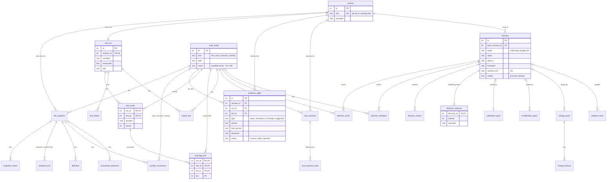

# Evidence database

CodeTwin keeps all evidence for a repository in one SQLite file, `.codetwin/evidence.sqlite`. Only `store/db.py`
(`Store`) reads or writes it; every other module goes through `Store` methods, so the schema can change without
touching callers. The schema is `src/codetwin/store/migrations/0003_evidence_model.sql`.

## Why it is normalized

Up to migration 0002 the store held one JSON blob per run, per file and per decision, plus a key–value `state`
table for learning histories. That was easy to write, but the database could not answer the questions the method
depends on. "Which tests executed line 42 of `price.py`?" needed every coverage blob loaded and parsed. "Which
decision is this calibration point from?" had no answer, because the histories were bare lists. And nothing stopped
a decision from pointing at a run that did not exist.

Since 0003, the layout follows the evidence model in Section IV of the paper:

* **Identities are stored once.** A path, commit or test file appears in one row of `revision` or `code_entity`, and
  everything else refers to it by id.
* **One row per fact.** Every list in the evidence model is its own table, so SQL can join, count and index it.
* **Typed links.** Each link records what kind of evidence found it (static, runtime, declared, co-change,
  suggested or unresolved) and where it came from. Unknown links are kept as rows (`unresolved_reference`) and are
  never silently dropped.
* **Integrity.** Foreign keys are on, `CHECK` constraints limit fields to their valid values (decision verdicts,
  modes, test-outcome sources, symbol kinds, labels in {0, 1}, α in (0, 1), risk in [0, 1]), and deleting a run,
  snapshot or decision deletes everything that hangs off it.
* **Audit trail.** Learning state is append-only and linked to the decision that produced it, so the history of
  αt and of every calibration point can be replayed.

## Entity–relationship diagram

The diagram lists the key columns of the central tables. The SQL file gives every column, with a comment on each.

## Tables by layer

| Layer | Tables | Filled by |
|---|---|---|
| Code model | `revision`, `code_entity` | every write; ids are created on first use |
| Static evidence | `file_snapshot` and its children `snapshot_import`, `snapshot_line`, `definition`, `symbol_occurrence`, `unresolved_reference`; `evidence_edge` (type `static`) | `codetwin record` → `Store.save_static` |
| Runtime evidence | `test_run`, `test_result`, `test_failure`, `coverage_line`, `import_line` | `codetwin record` → `Store.save_run` |
| Test history | `test_outcome`, `test_outcome_case` | recorded runs, `codetwin outcomes` (CI), `codetwin why` reruns |
| Decisions | `decision`, `decision_score`, `decision_selection`, `decision_reason`, `decision_outcome` | `codetwin select`, then `codetwin learn` |
| Learning | `calibration_point`, `recalibration_point`, `change_point`, `change_feature`, `adaptive_level` | `codetwin learn` |
| Scratch | `setting` (JSON) | values that are not evidence, e.g. features waiting for their label |

Runtime links are not copied into `evidence_edge`: they come from `coverage_line`. Keeping one copy means the two
can never disagree.

`evidence_edge` accepts four types. Only `static` is written today. The other three are reserved for the evidence
sources the paper proposes but does not evaluate. `declared` and `co-change` will need a writer before they are
used. `suggested` links come from a language model, and the paper never lets them drive selection.

## Views

| View | Answers |
|---|---|
| `evidence` | every typed link of a revision in one shape: static edges, runtime links (test → file, derived from coverage) and unresolved references (file → nothing) |
| `latest_run` | the most recent full run and its sha |
| `labelled_decision` | decisions together with their `learn` outcome; used for the observed miss rate (`/api/calibration`, `promise` report) |
| `flaky_test` | test files that both passed and failed on the same revision |

## Indexes

Every primary key is an index. In addition:

* `coverage_by_line (run_id, file_id, line)` answers "which tests executed this line" (`Store.tests_covering`)
  without scanning the run;
* `evidence_edge_dst (dst_id, revision_id)` gives reverse dependencies (who depends on this file);
* `test_outcome_by_test (test_id, recorded)` serves the per-test history that failure triage reads;
* `decision_by_mode (mode, id)` serves the miss-rate queries over calibrated decisions.

## Order and exactness

Some analysers emit lists in a meaningful order (for example `FileFacts.deps`). Tables holding such lists have an
`ordinal` column, so `get_static` and `get_run` return exactly what was written. The tests check this by round trip
(`tests/test_store.py`). Two things are deliberately not kept:

* a source file with an empty line list inside `covered` or `import_lines` (an empty set is not evidence);
* NaN scores, which SQL cannot represent; they are stored as null and read back as NaN.

## Transactions and migrations

The connection uses explicit transactions. Each `Store` write method is one transaction, and nested calls join the
outer one. So a decision and its selections, reasons and scores are stored together or not at all.

A migration is a `NNNN_<name>.sql` file. It is applied once, in name order, and tracked in the `migrations` table.
If a migration also has to move data, it registers a Python step in `store/legacy.py` (`STEPS`). The step runs in
the same transaction as the SQL, and the migration is recorded only if both succeed. If either fails, the database
stays exactly as it was (`test_failed_migration_step_rolls_back`).

Migration 0003 moves every row of the 0001/0002 tables into the new tables, keeping decision ids, and then drops the
old tables. Learning histories that the old store kept as bare lists come across in order but with no decision,
because the old store never recorded which decision they belonged to. The old `last_decision.scores` become the
scores of that decision. The upgrade was checked on 17 databases from earlier runs: runs, static facts, decisions and
outcomes all read back identically, and `pragma foreign_key_check` is clean.

## Portability

The schema uses only standard SQL types and constraints plus SQLite's `without rowid` tables. Moving to
PostgreSQL would mean changing `integer primary key` to an identity column and `real` to `double precision`, and
dropping `without rowid`. No query depends on JSON functions or on SQLite-specific behaviour.

## Not in this schema

The paper proposes cross-repository dependencies and API contracts as part of the evidence store. Today both are
read from configuration (`[crossrepo]`) and from the contract files in the repository, and are worked out when a
command runs. They get tables when their analyses start storing results. The cross-repository analysis reads a
dependent repository's own `.codetwin/evidence.sqlite` through `Store`.
